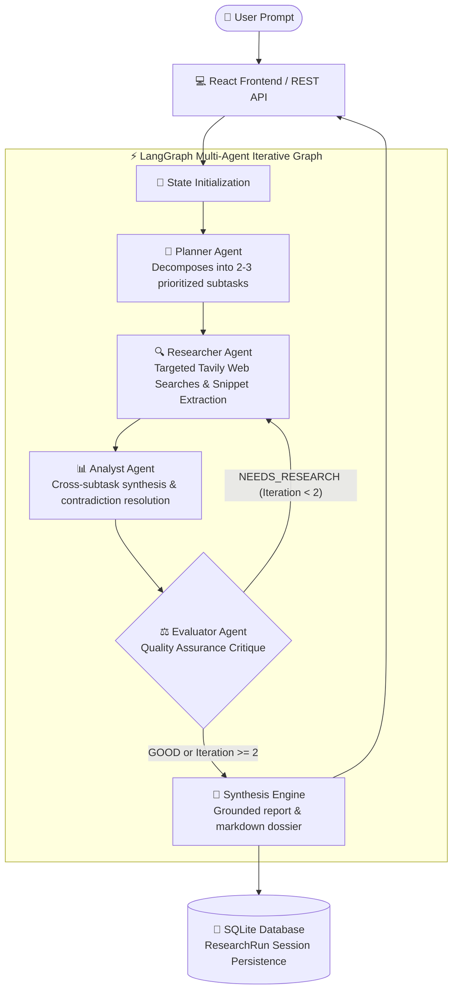

# ⚡ AURA — Autonomous Multi-Agent Research & Decision Assistant

> An enterprise-grade, full-stack Agentic AI system built with **LangGraph**, **FastAPI**, **Groq (`openai/gpt-oss-20b`)**, **Tavily Search**, **SQLite / SQLAlchemy**, and **React + Tailwind CSS**.

---

## 🏗️ System Architecture Flowchart



---

## 🌟 Core System Capabilities

1. **Autonomous Task Decomposition**: Breaks complex, multi-faceted inquiries into 2 to 3 targeted, actionable subtasks with optimized keyword queries.
2. **Domain-Specialized Research Nodes**: Categorizes research subtasks across `technical`, `pricing`, `performance`, and `general` domains.
3. **Iterative Multi-Agent Reflection**: The Evaluator Agent critiques drafted findings and conditionally routes back to the Researcher if critical gaps are identified.
4. **Infinite Loop Safeguards**: Implements hard cycle termination ($M=2$) preventing runaway API execution and token exhaustion.
5. **Full Persistence & History**: Automatically indexes every research run into SQLite with instant recall and sidebar session switching.
6. **Production-Grade Resilience**: Built-in exponential backoff retry wrappers on LLM rate limits (`429`), search failover strategies, and defensive Pydantic recovery parsers.

---

## 📁 Repository Structure

```
aura/
├── backend/
│   ├── src/
│   │   ├── agents/          # Agent nodes (Planner, Researcher, Analyst, Evaluator, Responder)
│   │   ├── api/             # FastAPI REST endpoints & routes
│   │   ├── chains/          # LangChain sequential sub-workflows
│   │   ├── db/              # SQLAlchemy models and SQLite session management
│   │   ├── tools/           # Tavily search & calculator tools with failovers
│   │   ├── utils/           # Error handlers, exponential backoff, parsers
│   │   ├── graph.py         # Compiled LangGraph state graph with conditional edges
│   │   ├── llm.py           # Model factory with Groq integration
│   │   ├── main.py          # FastAPI application server with CORS & lifespan
│   │   ├── schemas.py       # Pydantic structured output models
│   │   └── state.py         # TypedDict state schemas
│   └── tests/               # 20+ Unit, mock, and integration test suites
├── frontend/                # React + Vite + Tailwind CSS web interface
│   ├── src/
│   │   ├── api/             # Client API wrapper
│   │   ├── components/      # UI components (InputSection, AgentActivity, ResponseView, SourceList, Sidebar)
│   │   ├── App.jsx          # Master application layout and state management
│   │   └── index.css        # Glassmorphism dark-mode theme
│   └── package.json
├── TASKS.md                 # Granular 33-task project roadmap
├── requirements.txt         # Python dependencies
└── README.md
```

---

## 🚀 Quickstart & Setup Guide

### 1. Prerequisites
- Python 3.11+
- Node.js 18+ and npm
- [Groq API Key](https://console.groq.com)
- [Tavily API Key](https://app.tavily.com)

### 2. Environment Configuration
Create a `.env` file in the project root:
```env
GROQ_API_KEY=gsk_your_groq_api_key_here
TAVILY_API_KEY=tvly-your_tavily_api_key_here
DATABASE_URL=sqlite:///./aura.db
```

### 3. One-Command Launch (Backend + Frontend together) ⭐
```powershell
# Run both FastAPI backend and React frontend concurrently in 1 terminal
python run.py
```
- **Web App**: `http://localhost:5173`
- **FastAPI Docs**: `http://127.0.0.1:8000/docs`

---

### 4. Or Run Manually in Separate Terminals

#### Terminal 1 — FastAPI Backend:
```powershell
.\venv\Scripts\Activate.ps1
pip install -r requirements.txt
uvicorn backend.src.main:app --reload --port 8000
```

#### Terminal 2 — React Frontend:
```powershell
cd frontend
npm install
npm run dev
```
- **Web Application**: `http://localhost:5173`

### 5. Running the Test Suite
```powershell
$env:PYTHONPATH="."
pytest backend/tests/
```

---

## 🛡️ License
MIT License. Built for High-Precision Generative & Agentic AI Research.
